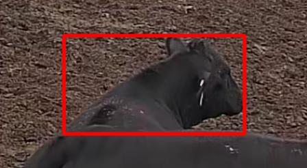
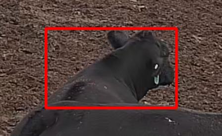
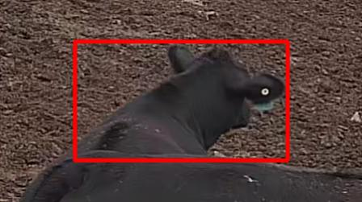
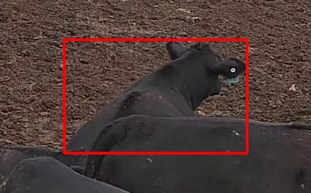
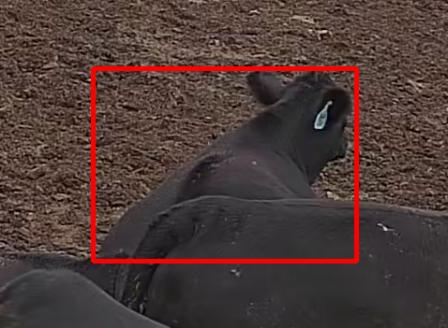
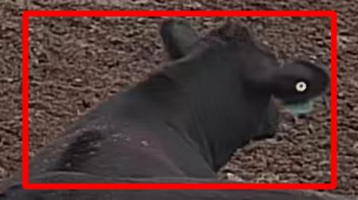

# Agent trace: day_lying_C08_1108_1606

**Case:** {"case_id": "day_lying_C08_1108_1606", "type": "behavior", "cow_id": "C08", "time": "2026-11-08 16:06:30", "rule_label": "lying", "night": "False"}

## Step 1: plan
- **model_output**: ```json
{
  "plan": ["view", "look_time"],
  "why": "To determine C08's behavior, we first need an overview of its position and then examine any changes in posture or movement over the past 20 seconds."
}
```
- **tools**: ['view', 'look_time']

## Step 2: tool_call
- **tool**: view
- **result**: cam03 crop of C08 at 16:06:29 (red box = C08)


## Step 3: tool_call
- **tool**: look_time
- **result**: cam03 crops of C08 at offsets -20s, -10s, +0s, +10s, +20s (left to right)






## Step 4: answer
- **round**: 1
- **model_output**: ```json
{
  "behavior": "ruminating_lying",
  "confidence": 0.9,
  "evidence": "Cow C08 is lying down with its head slightly raised and rhythmic jaw movements indicating rumination."
}
```

## Step 5: self_check
- **round**: 1
- **issues**: ["disagrees with rule label 'lying'"]

## Step 6: tool_call
- **tool**: zone_check
- **result**: bunk-zone distance -507px (>=0 inside), waterer distance -888px, nearest cow 2.83 body-heights away, 6 cows visible in Cam 03 at this moment

## Step 7: answer
- **round**: 2
- **model_output**: ```json
{
  "behavior": "ruminating_lying",
  "confidence": 0.9,
  "evidence": "Cow C08 is lying down, head slightly raised, and appears to be chewing rhythmically."
}
```

## Step 8: self_check
- **round**: 2
- **issues**: ["disagrees with rule label 'lying'"]

## Step 9: tool_call
- **tool**: zoom
- **result**: cam03 tight zoom of C08 at 16:06:29 (red box = C08)


## Step 10: answer
- **round**: 3
- **model_output**: ```json
{
  "behavior": "ruminating_lying",
  "confidence": 0.9,
  "evidence": "Cow C08 is lying down, head slightly raised, and appears to be chewing rhythmically."
}
```

## Step 11: self_check
- **round**: 3
- **issues**: ["disagrees with rule label 'lying'"]

## Step 12: decision
- **final_label**: ruminating_lying
- **method**: agent_corrected_rule
- **rule_label**: lying
- **agent_label**: ruminating_lying
- **agent_confidence**: 0.9

**Final:** {"label": "ruminating_lying", "method": "agent_corrected_rule", "agent_label": "ruminating_lying", "agent_confidence": 0.9, "rule_label": "lying"}