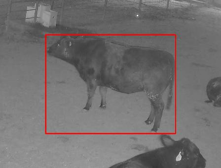
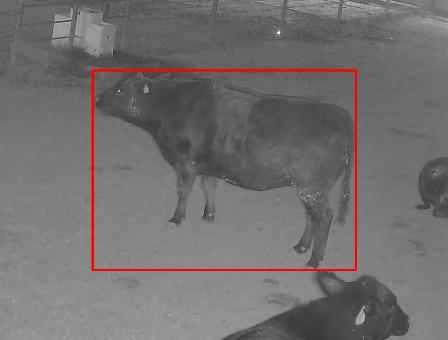
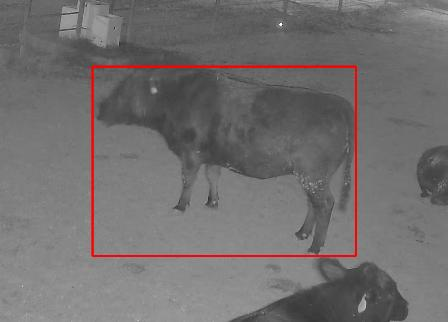
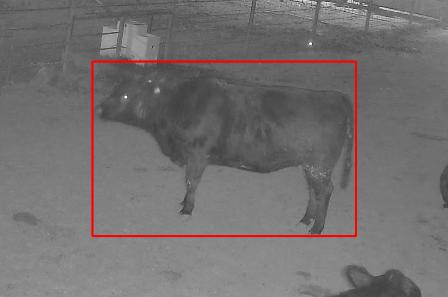
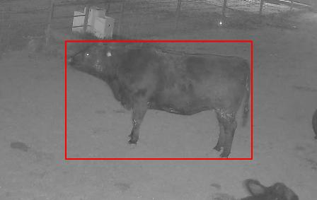

# Agent trace: night_C08_1108_0202

**Case:** {"case_id": "night_C08_1108_0202", "type": "behavior", "cow_id": "C08", "time": "2026-11-08 02:02:30", "rule_label": "standing", "night": "True"}

## Step 1: plan
- **model_output**: ```json
{
  "plan": ["view", "look_time"],
  "why": "To determine C08's behavior, first observe its overall posture and activity using the whole-pen camera, then check for any subtle changes in movement or posture over the past 20 seconds."
}
```
- **tools**: ['view', 'look_time']

## Step 2: tool_call
- **tool**: view
- **result**: cam03 crop of C08 at 02:02:29 (red box = C08)


## Step 3: tool_call
- **tool**: look_time
- **result**: cam03 crops of C08 at offsets -20s, -10s, +0s, +10s, +20s (left to right)






## Step 4: answer
- **round**: 1
- **model_output**: ```json
{
  "behavior": "standing",
  "confidence": 0.9,
  "evidence": "Cow C08 is standing still with no visible movement or interaction."
}
```

## Step 5: self_check
- **round**: 1
- **issues**: ['consistent']

## Step 6: decision
- **final_label**: standing
- **method**: agent_verified
- **unresolved_issues**: []
- **rule_label**: standing
- **agent_label**: standing
- **agent_confidence**: 0.9

**Final:** {"label": "standing", "method": "agent_verified", "agent_label": "standing", "agent_confidence": 0.9, "rule_label": "standing"}